<p align="center">
  
</p>

<p align="center">
  
  
  
  
  
  
</p>

<p align="center">
  <b>English</b> · <a href="README.id.md">Bahasa Indonesia</a>
</p>

---

ChordKu turns **any song into a chord chart**. Paste a YouTube link (or anything yt-dlp
understands), drop an audio file, or record with the microphone. A few seconds later you get a
bar-by-bar chart that follows the music, in the key you want to play it in.

Everything runs locally: a single Rust binary with ONNX Runtime built in. No account, no cloud,
no Python at runtime. The UI is in Indonesian.

## Highlights

- **Chords, beats, key, sections.** A 170-class chord recogniser (maj, min, 7, maj7, m7, sus, dim,
  aug, 6, ...) snapped to the bar grid, with tuning correction for recordings that are not at
  A = 440 Hz and detection of last-chorus key changes.
- **Transpose and capo.** Move the song up or down (the audio is pitch-shifted along), get capo
  suggestions ranked by how easy the shapes are, switch to Nashville numbers, simplify chords.
- **Synced player.** The beat that is sounding lights up. Loop a section or an A-B range, slow
  down to 50 % without changing pitch.
- **Floating chord diagrams.** A draggable cheat-sheet that stays visible while the chart
  scrolls: guitar, ukulele, piano or all three, for the current and the upcoming chords.
- **Stem separation** (optional). Vocals, drums, bass, other. Mute the singer, solo the bass.
- **Fix what the machine got wrong.** Tap a chord, pick one of the recogniser's alternatives or
  any other chord. Corrections survive a re-analysis.
- **Library.** Search, tags, favourites, setlists; export to ChordPro, plain text or PDF.
- **From your phone.** Opt-in HTTPS mode on your Wi-Fi with QR pairing.

<p align="center">
  
</p>

## How it works

<p align="center">
  
</p>

Two lanes share one inference thread. The fast lane (tuning, beats, chords, chart) finishes in
seconds and always goes first; stem separation runs in the background and yields to it between
segments. Details and the reasons behind each decision: [docs/ARCHITECTURE.md](docs/ARCHITECTURE.md).

## How fast, how accurate

<p align="center">
  
</p>

Measured on a Core Ultra 5 125H laptop with an RTX 3050:

| | |
|---|---|
| 4 min song, upload to visible chart | **4.1 s** (about 7 s on the CPU alone) |
| 10 min video, CPU only | about 17 s |
| Stem separation, NVIDIA GPU (CUDA) | about **30 s** for a 4 min song |
| Stem separation, CPU only | 0.30 x real time, 2.5 GB peak memory, in the background |

Weighted chord symbol recall on 91 minutes of real guitar recordings (GuitarSet, 180 comping
takes, see [docs/ACCURACY.md](docs/ACCURACY.md)): **root 82.9 %, major/minor 79.2 %, sevenths
67.6 %** overall; **90-92 % major/minor** on the rock and singer-songwriter takes, 60-69 % on funk
and jazz. Expect charts that are right most of the time and quick to correct where they are not.

## Every processor, measured

<p align="center">
  
</p>

ChordKu benchmarks every model on the CPU, the NVIDIA GPU, the Intel GPU and the NPU, and uses a
device only if it is measurably faster **and** numerically faithful. On the development laptop
that means beats and stems on the RTX 3050, chords on the CPU, and the NPU unused because it
measured no faster or gave wrong results. The CUDA runtime (about 1.5 GB) is downloaded from
inside the app, pinned by SHA-256. Full table and reasoning:
[docs/ACCELERATION.md](docs/ACCELERATION.md).

## Run it (Windows 11)

Needs: Rust (MSVC), Visual Studio Build Tools with the CMake component, Node.js 22+, Python 3.11
(setup only), Git.

```powershell
git clone https://github.com/yoelkh/chordku.git
cd chordku
tools\setup.ps1      # once: exports the chord model, builds the UI
tools\run.ps1        # builds and opens http://127.0.0.1:7464
```

On first use open **Pengaturan > Model** and download the beat tracker (11 MB, required) and, if
you want stems, the separator (171 MB). yt-dlp is installed automatically with a verified checksum
the first time you add a link; YouTube additionally needs Node.js 22+ or Deno on the PATH.

`tools\build-release.ps1` assembles a portable `dist\ChordKu` folder.

Environment variables: `CHORDKU_PORT` (7464), `CHORDKU_DATA` (default
`%LOCALAPPDATA%\ChordKu\data`), `CHORDKU_MODELS`, `CHORDKU_THREADS`, `CHORDKU_MAX_SECONDS` (1200),
`CHORDKU_MAX_UPLOAD_MB` (300), `CHORDKU_MIN_FREE_MB` (1536), `CHORDKU_CUDA`, `CHORDKU_NO_ACCEL`.

## Tips

- **Floating diagrams**: drag the panel by its header, choose Gitar, Ukulele, Piano or Semua
  (all three), tap a diagram for another voicing, collapse it to a one-line chip (current and
  next chord). On phones it starts collapsed. The toggle is in the song toolbar.
- **Koreksi chord**, then tap the wrong chord. Tap an empty beat inside a bar to start a new
  chord there.
- If the "one" is off, use **Lainnya > Geser hitungan "satu"**. Double or half tempo and 3/4 or
  6/8 metre are in the same menu.
- Shortcuts: space (play/pause), left/right (5 s), `[` and `]` (transpose).
- Microphone recordings work best at 20 s or longer, without much talking over them.

## Command line

```
chordku-cli analyze  song.mp3 [--json out.json]    key, tempo, sections and bars
chordku-cli chords   song.mp3 [--lab out.lab]      frame-level chord labels
chordku-cli beats    song.mp3                      beats and downbeats
chordku-cli separate song.mp3 out_dir              four stems as WAV
chordku-cli eval     dir_with_audio_and_lab        WCSR against ground truth
chordku-cli bench    song.mp3                      speed and fidelity per model and device
```

## Tests

```
cargo test --workspace        # 50+ unit, property and golden parity tests
cd web; npm test              # theory, chart edits, exports (vitest + fast-check)
cd web; npm run check         # svelte-check
node tools/lan-check.mjs <ip>:7465 <code>    # LAN mode over HTTP/2, like a phone
```

## Documentation

- [docs/ARCHITECTURE.md](docs/ARCHITECTURE.md): pipeline, crates, the decisions behind them, security model
- [docs/MODELS.md](docs/MODELS.md): which models, why, licenses, export and parity tests
- [docs/ACCURACY.md](docs/ACCURACY.md): measurements and how to run your own
- [docs/ACCELERATION.md](docs/ACCELERATION.md): CPU, GPU and NPU measurements, the device plan
- [docs/LAN.md](docs/LAN.md): phone access, certificates, pairing
- [THIRD_PARTY.md](THIRD_PARTY.md): credits and licenses

## Fair use

ChordKu is a practice tool. Download only what you are allowed to, for your own study. The
separator's pretrained weights are offered by their authors for research and personal use; ChordKu
does not distribute them.

[MIT License](LICENSE).
